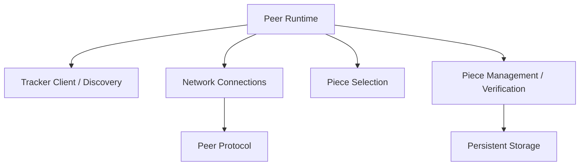

# PeerTorrent Module Interfaces

This document describes the main responsibilities and conceptual interfaces of PeerTorrent's modules. The concrete Python method signatures and return types are determined by the implementation in `src/`.

## 1. Common Types

The common data concepts include:

### `PeerInfo`

Represents a peer participating in a swarm. Relevant information includes its peer ID, IP address, and listening port.

### `PieceInfo`

Represents a piece within a file. Relevant information includes the piece index, size, and expected hash.

### `FileMetadata`

Describes the shared file, including its name, size, piece size, piece count, and per-piece hash information.

Use the actual definitions in `src/common/types.py` and the metadata implementation as the source of truth for concrete fields.

## 2. Pieces and Storage

### Piece management

The piece-management layer tracks the pieces associated with a file and the local peer's progress.

Its responsibilities include:

- Determining which pieces are missing.
- Checking whether a piece is available locally.
- Providing piece information or data.
- Updating completion state.
- Determining whether all pieces are available.

The main implementation is under `src/pieces/`.

### Piece storage

The storage layer persists pieces and retrieves them when needed.

Its responsibilities include:

- Saving piece data.
- Loading stored pieces.
- Checking local piece availability.
- Managing the on-disk representation of pieces.

The main implementation is under `src/storage/`.

### File operations

File operations support preparing source data and reconstructing an output from ordered pieces. Reconstructed content should be based on valid, verified piece data.

## 3. Tracker

The tracker provides peer registration and discovery for file-specific swarms.

### Peer registry

The peer registry maintains information about peers known to the tracker. Its responsibilities include registering, removing, and looking up peers.

### Swarm manager

The swarm manager associates peers with the files they are sharing and provides peer information for a particular file swarm.

### Tracker server

The tracker server receives HTTP requests, validates them, and returns the appropriate response. The documented endpoints include `/health`, `/stats`, `/peers`, and `/announce`.

The tracker implementation is under `src/tracker/`. The tracker provides discovery and swarm management; it does not transfer file pieces.

## 4. Protocol

The protocol layer defines the messages used between peers.

### Message representation

A peer message contains a message type and a payload.

### Encoder and decoder

The encoder serializes messages for transmission. The decoder converts received payload bytes into messages and validates their structure.

### Handshake

The handshake identifies the peer and the file ID associated with the active session.

The implementation is under `src/protocol/`. See `message_format.md` for message types and framing details.

## 5. Network

The network layer manages TCP connections and the movement of encoded messages.

Its responsibilities include:

- Creating and managing sockets.
- Establishing peer connections.
- Sending and receiving messages.
- Tracking active connections.
- Closing connections and handling connection failures.

The implementation is under `src/network/`.

## 6. Peer Runtime

The peer runtime integrates the tracker client, networking, protocol handling, piece management, and storage.

### Download manager

Coordinates the downloading side of the peer, including selecting requests to make, handling received piece data, and updating download state.

### Upload manager

Handles incoming piece requests, checks local availability, reads requested pieces from storage, and sends piece data to requesting peers.

### Request manager

Tracks piece requests and related state so that requests can be coordinated and completed or cancelled as needed.

### Scheduler

Coordinates peer actions such as selecting pieces, making requests, and processing transfer progress.

### Peer state

Maintains the runtime information needed by the peer, such as connected peers, piece availability, and request state.

### Choking manager

Coordinates choking-related behavior that determines whether a peer may make piece requests to another peer.

The peer runtime is centered on `src/peer/peer.py`; related implementations live in `src/peer/`.

## 7. Piece Selection

The selection implementations are under `src/selection/`.

The documented strategies are:

- `SequentialSelector` — selects pieces in sequential order.
- `RandomSelector` — selects an available required piece randomly.
- `RarestFirstSelector` — prioritizes required pieces that are less commonly available among connected peers.

Selection is concerned with which piece to request. The peer and download-management components coordinate the actual request and transfer.

## 8. High-Level Dependencies

This is a conceptual dependency diagram, not a complete call graph. The exact interactions are defined by the current implementation.

## 9. Interface and Documentation Rules

- Treat the source code as authoritative for actual method names, arguments, and return types.
- Keep message definitions consistent with `message_format.md`.
- Keep tracker API details consistent with `protocol_specification.md`.
- Keep architecture descriptions consistent with `architecture.md`.
- Verify behavior with tests rather than relying on an interface description alone.

The purpose of these boundaries is to make responsibilities understandable and to reduce unnecessary coupling between modules.