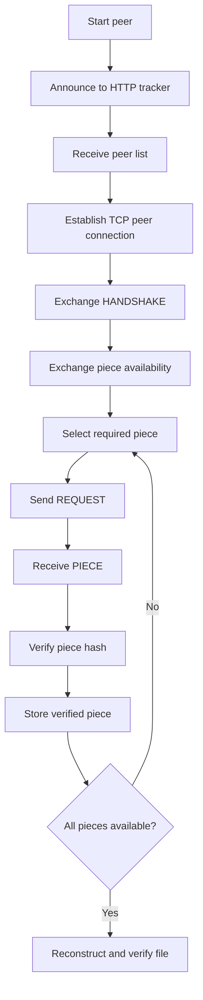

# PeerTorrent Protocol Specification

This document describes the communication paths used by PeerTorrent: the HTTP/JSON tracker API and the TCP peer-to-peer protocol.

## 1. Protocol Overview

PeerTorrent uses the tracker to discover peers and uses direct TCP connections to exchange file pieces.



The diagram shows the general flow. Connection failures, unavailable pieces, and invalid data must be handled according to the relevant runtime logic.

## 2. Tracker Communication: HTTP/JSON

The tracker exposes an HTTP API. The documented default address is:

```text
http://127.0.0.1:6969
```

The tracker handles discovery and swarm membership; it does not transfer piece data.

### `POST /announce`

An announce request contains peer and file information. The documented fields include:

```json
{
  "peer_id": "peer-1",
  "ip": "127.0.0.1",
  "port": 6881,
  "file_id": "<metainfo file id>",
  "left": 1048576,
  "uploaded": 0,
  "downloaded": 0,
  "is_seeder": false
}
```

A successful response includes `ok: true`, `type: "ANNOUNCE_RESPONSE"`, and a `peers` list containing discovered peers other than the announcing peer.

### `GET /peers`

Example:

```text
GET /peers?peer_id=peer-1&file_id=<metainfo-file-id>
```

The response includes `type: "GET_PEERS_RESPONSE"` and a `peers` list. The documented API requires query parameters to occur once and not be empty.

### `GET /health`

Provides a basic tracker liveness response.

### `GET /stats`

Reports tracker statistics, including peer, seeder, leecher, uploaded-byte, and downloaded-byte counters.

Invalid JSON and invalid fields produce HTTP 4xx responses with JSON error information. Oversized announce bodies are rejected.

## 3. Peer Connections

After discovering peers through the tracker, a peer attempts to establish TCP connections with them.

```text
Peer A ───────── TCP connection ───────── Peer B
```

The network module manages peer connections. A failed connection should not automatically terminate the entire download; the peer may continue using other available connections.

## 4. Handshake

After establishing a connection, peers exchange `HANDSHAKE` messages. The handshake identifies the sender's peer ID and the file ID.

```text
Peer A                         Peer B
  │────── HANDSHAKE ───────────>│
  │<───── HANDSHAKE ────────────│
```

The received file ID should match the file associated with the active peer session before normal piece exchange continues.

## 5. Piece Availability

Peers exchange piece-availability information, including `BITFIELD` messages. A bitfield indicates which pieces the sender currently has.

For example:

```text
Peer A: 1 1 0 0 1 0
Peer B: 0 1 1 1 0 1
```

A peer can use the remote availability information to determine whether the remote peer has pieces it needs. Availability can change as peers acquire pieces; `HAVE` announces a newly obtained piece.

## 6. Interest and Choking

A peer sends `INTERESTED` when the remote peer has pieces it needs. It sends `NOT_INTERESTED` when it currently needs no pieces from that peer.

`CHOKE` temporarily prevents a peer from making piece requests to the sender. `UNCHOKE` allows requests again. The precise behavior depends on the peer's choking and request-management logic.

## 7. Piece Requests and Transfers

A peer requests a piece using a `REQUEST` message containing a `piece_index`.

```json
{
  "type": "REQUEST",
  "payload": {
    "piece_index": 4
  }
}
```

If the requested piece is available, the receiving peer can respond with a `PIECE` message containing the piece index and data. The message format and Base64 representation of binary data are documented in `message_format.md`.

A peer should not serve invalid piece data when a requested piece is unavailable.

## 8. Cancellation

A `CANCEL` message identifies a piece request that the sender no longer wants fulfilled.

The receiving peer asks its upload manager to update tracking state for the relevant peer and piece. Cancellation does not necessarily interrupt data already being transmitted.

## 9. Piece Verification

After receiving piece data, the peer checks it against the expected piece hash from metadata.

```text
Received piece data
        ↓
Calculate piece hash
        ↓
Compare with expected hash
        ↓
  ┌─────┴─────┐
  Match     Mismatch
    ↓           ↓
Accept and    Reject as
store piece   invalid data
```

Only successfully verified pieces should be treated as valid. Once a piece is accepted, the peer updates its local piece state and can notify connected peers using `HAVE`.

## 10. Download Loop

A simplified download loop is:

1. Determine which pieces are missing.
2. Check availability from connected peers.
3. Select a required piece using the configured strategy.
4. Request the piece from a peer that has it.
5. Receive and decode the response.
6. Verify the piece.
7. Store valid data and update local state.
8. Announce new availability.
9. Repeat until all required pieces have been obtained.

The piece-selection strategy can be changed independently of the message definitions.

## 11. File Reconstruction

When all required pieces have been obtained and verified, the file can be reconstructed by ordering pieces by index and combining their data.

The resulting file should be checked against the metadata, including file size and whole-file hash when available.

## 12. Upload Flow

When a peer receives a piece request, the upload path broadly follows these steps:

1. Validate the request.
2. Check whether the requested piece exists.
3. Read the piece from storage.
4. Construct the `PIECE` message.
5. Encode and transmit the response.

Requests for unavailable or invalid pieces should be handled safely.

## 13. Connection Failures and Invalid Messages

A peer should handle connection loss by updating connection and peer state and continuing with other usable peers where possible.

Incoming messages should be framed, decoded, checked for a recognized type, and validated before being passed to peer logic. Invalid or incomplete messages should be rejected safely.

A corrupted piece must not be accepted as verified data.

## 14. Protocol Rules

1. Peer-to-peer connections use TCP.
2. The tracker is used for peer discovery, not piece transfer.
3. A handshake identifies the peer and active file.
4. Piece availability should be exchanged before selecting a piece.
5. A peer should request pieces it still needs.
6. Received piece data must be verified before it is accepted as valid.
7. New piece availability can be announced with `HAVE`.
8. Invalid messages and corrupted data must be handled safely.
9. A failed peer connection should not necessarily stop the entire download.
10. Tracker HTTP messages and peer wire messages are distinct protocols.

## 15. Related Documentation

- `message_format.md` describes peer message types, payloads, and TCP framing.
- `module_interfaces.md` describes internal software-module responsibilities and interfaces.
- `architecture.md` describes the system components and their relationships.
- `setup_guide.md` describes how to run the tracker, peers, and verification workflow.